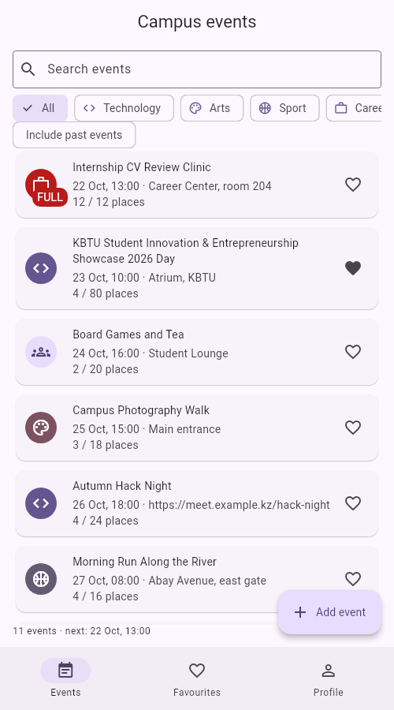
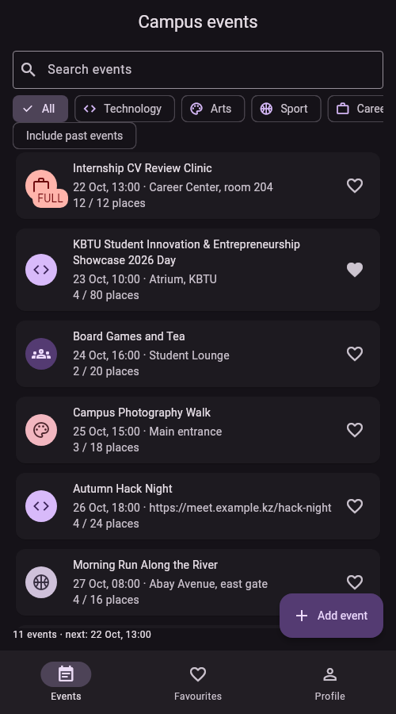
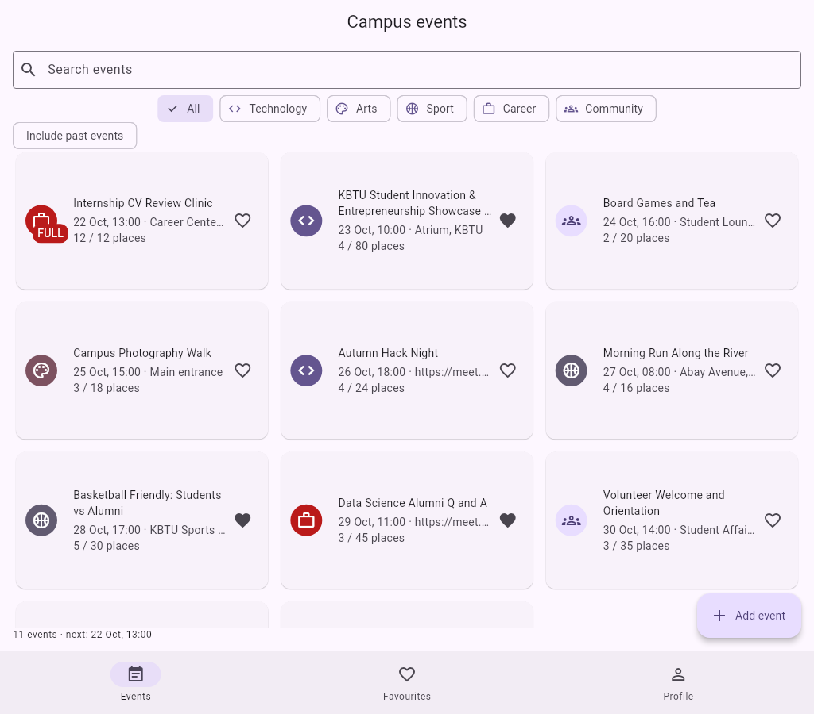

# Lab 01 — Campus Events

Campus Events is a student event browser for a university community. It includes a searchable, filterable event catalogue, favourites, event details and attendee registration, an event editor, a profile tab, and light/dark/system themes. The app seeds twelve events and keeps edits in memory for the current run.

## Decisions

I chose a campus event catalogue because it combines event discovery with a realistic student profile and registration flow. `Event` and `Profile` are immutable models; event attendee names are copied into an unmodifiable list, and `copyWith` creates updated values. The catalogue and profile state live in the root tab shell so favourites, registration counts, and details stay synchronized. Named routes pass typed argument objects, while the edit form returns its saved `Event` through the navigation result. A sealed `Countdown` represents upcoming, currently running, and ended events, which keeps the detail header's state handling exhaustive. The event list switches between a one-column list and a constrained grid based on available width, and long content remains scrollable. Validation is attached to form fields, and `PopScope` asks before discarding edits.

## Screenshots

- Phone, light theme: 
- Phone, dark theme: 
- Tablet event grid: 

## Run

Open this folder in IntelliJ IDEA and run `lib/main.dart`, or use:

```sh
flutter pub get
flutter run
```

The event header illustration is bundled at `assets/images/campus_event_header.png`.
